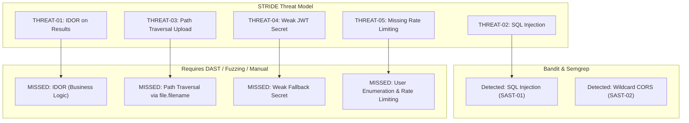

# Static Security Analysis & Triaged Findings Report

**Project:** Exam Verification & Integrity System  
**Phase:** Phase 3 (Static Application Security Testing - SAST & SCA)  
**Tools Executed:**
1. **Bandit** (AST-based Python Security Linter - v1.8.6)
2. **Semgrep** (Rule-based Semantic & Pattern Security Engine - v1.136.0 with `owasp-top-ten` and `security-audit` rulesets)
3. **pip-audit** (Software Composition Analysis / Supply Chain CVE Scanner - v2.9.0)

---

## 1. Executive Summary & Scan Statistics

| Metric | Bandit | Semgrep | pip-audit | Total / Aggregated |
|---|---|---|---|---|
| **Files Scanned** | 14 files (638 LOC) | 14 files | Virtual Environment | **14 code files + 38 dependencies** |
| **Rules Applied** | Standard Python AST rules | 324 OSS rules (`owasp-top-ten`, `security-audit`) | PyPI Advisory DB / OSV | **324+ rules** |
| **Total Flags** | 2 issues | 2 issues | 38 CVEs (in 14 packages) | **42 total advisories** |
| **True Positives (Code)** | 1 (SQLi) | 2 (SQLi, Wildcard CORS) | 14 (Outdated local packages) | **3 unique code-level findings** |
| **False Positives / Informational** | 1 (Bind 0.0.0.0) | 0 | 0 | **1 informational / won't-fix** |
| **Logical Flaws Missed (SAST Blindspots)** | 3 (IDOR, Path Traversal, User Enum) | 3 (IDOR, Path Traversal, User Enum) | N/A | **3 critical architectural flaws missed** |

---

## 2. Triaged Findings Matrix & OWASP Mapping

| Finding ID | Source Tool | Location / File | Vulnerability / Issue Description | OWASP Top 10 (2021) | Severity | Triage Status | Justification & Technical Assessment |
|---|---|---|---|---|---|---|---|
| **SAST-01** | Semgrep (`avoid-sqlalchemy-text`) & Bandit (`B608`) | `app/routers/results.py:82-90` | **SQL Injection via String-Formatted Query:** User-controlled input `query` is interpolated directly into an SQL string without bind parameters or ORM escaping. | **A03:2021 - Injection** | **High** | **True Positive** | **Confirmed Critical Flaw:** Directly exploitable by an authenticated invigilator/attacker to execute UNION-based data extraction or mutate tables. |
| **SAST-02** | Semgrep (`wildcard-cors`) | `app/main.py:25` | **Permissive CORS Wildcard Policy (`*`):** `CORSMiddleware` configured with `allow_origins=["*"]` and `allow_credentials=True`. | **A05:2021 - Security Misconfiguration** | **Medium** | **True Positive** | **Confirmed Flaw:** Allows arbitrary third-party web domains to make cross-origin requests to API endpoints, potentially exposing student responses in authenticated browser sessions. |
| **SAST-03** | Bandit (`B104`) | `app/main.py:47` | **Bind to All Network Interfaces (`0.0.0.0`):** Uvicorn server entrypoint binds to all available network adapters. | **A05:2021 - Security Misconfiguration** | **Low** | **Won't-Fix (Contextual)** | **Acceptable in Container:** Required inside Docker container to accept forwarded ingress traffic from port 8000. In standalone bare-metal production, this should bind to loopback (`127.0.0.1`) behind a reverse proxy (Nginx). |
| **SCA-01** | pip-audit | `python-multipart` (0.0.20), `starlette` (0.49.3), `urllib3` (2.6.3) | **Known Supply Chain CVEs in Dependencies:** Multipart parser and ASGI middleware contain known Denial of Service and header parsing advisories (e.g., `PYSEC-2026-1852`). | **A06:2021 - Vulnerable and Outdated Components** | **Medium** | **True Positive** | **Confirmed Supply Chain Risk:** Upgrading base requirements and pinning patched versions eliminates known parser exploits. |

---

## 3. Deep-Dive SAST Code Analysis

### 3.1 SAST-01: SQL Injection in Result Search
- **Tool Trigger:** Bandit `[B608:hardcoded_sql_expressions]` & Semgrep `python.sqlalchemy.security.audit.avoid-sqlalchemy-text`
- **Vulnerable Snippet:**
  ```python
  # app/routers/results.py:82-90
  raw_query = f"""
      SELECT r.id, r.score, r.grade, r.integrity_status, u.username, u.full_name, s.course_code
      FROM exam_results r
      JOIN users u ON r.student_id = u.id
      JOIN exam_sessions s ON r.session_id = s.id
      WHERE u.username LIKE '%{query}%' OR u.full_name LIKE '%{query}%'
  """
  cursor = db.execute(text(raw_query))
  ```
- **Remediation Recommendation:** Replace `text(f"...")` with parameterized queries using SQLAlchemy ORM expressions:
  ```python
  pattern = f"%{query}%"
  results = db.query(ExamResult).join(User).join(ExamSession).filter(
      (User.username.ilike(pattern)) | (User.full_name.ilike(pattern))
  ).all()
  ```

### 3.2 SAST-02: Permissive CORS Configuration
- **Tool Trigger:** Semgrep `python.fastapi.security.wildcard-cors.wildcard-cors`
- **Vulnerable Snippet:**
  ```python
  # app/main.py:25
  app.add_middleware(
      CORSMiddleware,
      allow_origins=["*"],
      allow_credentials=True,
      allow_methods=["*"],
      allow_headers=["*"],
  )
  ```
- **Remediation Recommendation:** Specify an explicit whitelist of trusted frontend origins (e.g., `["https://exam.university.edu"]`).

---

## 4. Critical Methodological Analysis: SAST Blindspots vs. Design-Time Threat Model

A central academic contribution of this portfolio is analyzing **what SAST tools succeed at catching versus what they fail to detect**:



### Why SAST Tools Missed the Other Vulnerabilities:
1. **IDOR (`GET /api/results/{id}`):** Syntactically, the function is valid Python and SQLAlchemy. The flaw is an absence of an *authorization rule* comparing the logged-in user with the owner of the entity. Static analyzers cannot infer domain authorization policies without custom business logic rules.
2. **Path Traversal (`POST /api/submissions/upload`):** `os.path.join(settings.UPLOAD_DIR, file.filename)` is standard syntax. Without cross-file taint analysis tracking `file.filename` from the HTTP request to the filesystem sink, basic AST analyzers treat it as safe.
3. **Authentication Flaws (`POST /api/auth/login`):** Differentiated error strings (`"User not found"` vs `"Incorrect password"`) and missing rate limit decorators are conceptual design flaws that require dynamic security testing (DAST) and API fuzzing.

---

## 5. Next Steps for Phase 4 (Dynamic, Fuzzing & Manual Testing)

The blindspots identified in this static analysis directly dictate the target surface for Phase 4:
1. **Targeted Fuzzing (Schemathesis):** Fuzz endpoint inputs against the OpenAPI contract to observe 500 errors and unhandled edge cases.
2. **OWASP ZAP Dynamic Scan:** Automated baseline and active scan against the running API container.
3. **Manual DAST Verification:** Exploit verification for the unspotted logical flaws:
   - IDOR testing across distinct student accounts.
   - Path traversal exploit payload (`../../`).
   - SQLi verification with error-based and boolean payloads.
   - JWT secret cracking and forgery.
