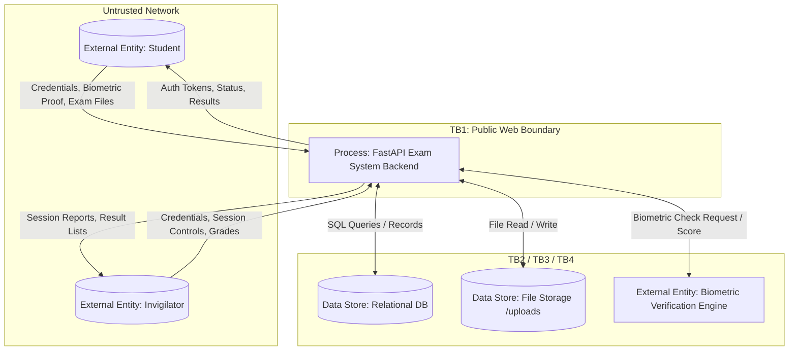

# Design-Time Threat Model & STRIDE Analysis
**Target System:** Exam Verification & Integrity System  
**Methodology:** Microsoft STRIDE per Element & Data Flow Diagram (DFD) Modeling  
**Phase:** Phase 2 (Design-Time Pre-Scanner Analysis)

---

## 1. System Overview & Scope

The Exam Verification System is a security-sensitive web service designed to manage high-stakes online examinations. It coordinates user authentication, candidate identity verification (facial/biometric simulation), exam file submissions with cryptographic checksum verification, grading, and result publication.

### Trust Boundaries
1. **TB1 (Client / External Network Boundary):** Separates untrusted end-user clients (students, invigilators, malicious external actors) from the API backend.
2. **TB2 (Process / Storage Boundary):** Separates the FastAPI runtime processes from persistent relational storage (`SQLite`/`PostgreSQL`).
3. **TB3 (Process / File System Boundary):** Separates the FastAPI runtime process from the local operating system file storage (`/uploads`).
4. **TB4 (Process / Third-Party External Boundary):** Separates internal business logic from external mock biometric / identity verification services.

---

## 2. Data Flow Diagrams (DFD)

### 2.1 DFD Level 0: Context Diagram


---

### 2.2 DFD Level 1: Decomposed Process Diagram
```mermaid
flowchart TD
    %% Entities
    E1["Entity: Student Client"]
    E2["Entity: Invigilator Client"]
    E3["External Service: Mock Biometric Engine"]

    %% Processes
    P1["P1: Authentication & JWT Issuer"]
    P2["P2: Exam Session Controller"]
    P3["P3: Identity Verification Handler"]
    P4["P4: Submission & Hash Validator"]
    P5["P5: Grading & Result Engine"]
    P6["P6: Search & Filter Query Dispatcher"]

    %% Data Stores
    DS1[("DS1: Relational Database (Users, Sessions, Results)")]
    DS2[("DS2: Submissions File Storage")]

    %% Trust Boundaries
    subgraph TB1 ["Trust Boundary 1: Client / Server Interface"]
        E1
        E2
    end

    subgraph Backend ["Exam System Core Application Process"]
        P1
        P2
        P3
        P4
        P5
        P6
    end

    subgraph TB2 ["Trust Boundary 2: Process to Database"]
        DS1
    end

    subgraph TB3 ["Trust Boundary 3: Process to File System"]
        DS2
    end

    subgraph TB4 ["Trust Boundary 4: Process to External Biometrics"]
        E3
    end

    %% Flows
    E1 -->|DF01: Login / Register (POST /api/auth/*)| P1
    E2 -->|DF01: Login / Register (POST /api/auth/*)| P1
    P1 <-->|DF02: User Credential Lookup & Insert| DS1
    P1 -->|DF03: JWT Access Token| E1
    P1 -->|DF03: JWT Access Token| E2

    E2 -->|DF04: Session Creation (POST /api/sessions)| P2
    P2 <-->|DF05: Session Data Persist/Query| DS1

    E1 -->|DF06: Biometric Data (POST /api/sessions/{id}/verify-identity)| P3
    P3 <-->|DF07: Verification Request & Score| E3
    P3 <-->|DF08: Verification Record Insert| DS1

    E1 -->|DF09: File Upload + Hash (POST /api/submissions/upload)| P4
    P4 <-->|DF10: Verification Status Pre-Check| DS1
    P4 -->|DF11: Write Raw File Payload| DS2
    P4 -->|DF12: Submission Metadata & Hash Record| DS1

    E2 -->|DF13: Publish Grade (POST /api/results)| P5
    P5 <-->|DF14: Result Record Insert| DS1
    E1 -->|DF15: View Result (GET /api/results/{id})| P5
    P5 <-->|DF16: Read Result Record| DS1

    E2 -->|DF17: Search Query (GET /api/results/search/query)| P6
    P6 <-->|DF18: Execute Dynamic Search Query| DS1
```

---

## 3. Systematic STRIDE Mapping per DFD Element

| DFD Element | Element Type | S (Spoofing) | T (Tampering) | R (Repudiation) | I (Info Disclosure) | D (Denial of Service) | E (Elevation of Privilege) |
|---|---|:---:|:---:|:---:|:---:|:---:|:---:|
| **P1: Auth & JWT Issuer** | Process | ✔ (Forged token/Weak secret) | ✔ (Modified token claims) | ✔ (Unlogged failed logins) | ✔ (User enumeration in error msgs) | ✔ (Credential brute force) | ✔ (Role claim tampering) |
| **P2: Session Controller** | Process | ✔ (Impersonate invigilator) | ✔ (Altering session active window) | ✔ (Unrecorded session edits) | ✔ (Leaking inactive exam details) | ✔ (Session exhaustion) | ✔ (Unauthorized session creation) |
| **P3: Identity Verifier** | Process | ✔ (Spoofed biometric payload) | ✔ (Confidence score manipulation) | ✔ (Disputed verification failure) | ✔ (Leaking student biometric data) | ✔ (Flooding verification endpoint) | ✔ (Bypassing verification check) |
| **P4: Submission & Hash Validator** | Process | ✔ (Submitting as another student) | ✔ (Altering file contents / Hash bypass) | ✔ (Claiming unmade submission) | ✔ (Reading stored exam solutions) | ✔ (Large file storage exhaustion) | ✔ (Path traversal / Overwriting system files) |
| **P5: Grading & Result Engine** | Process | ✔ (Faking invigilator identity) | ✔ (Unauthorized grade modification) | ✔ (Denying grade publication) | ✔ (IDOR - reading peer grades) | ✔ (Result query exhaustion) | ✔ (Horizontal & vertical privilege bypass) |
| **P6: Search Query Dispatcher** | Process | ✔ (Attacker-injected DB context) | ✔ (SQL Injection payload tampering DB) | ✔ (Unlogged SQL execution) | ✔ (SQLi exfiltrating password hashes) | ✔ (ReDoS / SQL `SLEEP` DoS) | ✔ (Database administrative takeover via SQLi) |
| **DS1: Relational Database** | Data Store | ✔ (Impersonating DB client) | ✔ (Direct DB record tampering) | ✔ (Lack of audit log trail) | ✔ (Plaintext data exposure in DB) | ✔ (Connection pool exhaustion) | ✔ (DB privilege escalation) |
| **DS2: Submissions File Storage** | Data Store | ✔ (Arbitrary file masquerading) | ✔ (Direct file overwrite/corruption) | ✔ (No file version history) | ✔ (Direct file browsing) | ✔ (Disk space exhaustion) | ✔ (Execution of uploaded scripts) |
| **DF09 & DF11: File Data Flows** | Data Flow | ✔ (MIME-type spoofing) | ✔ (In-transit file modification) | ✔ (Drop file transmission) | ✔ (Sniffing cleartext submission) | ✔ (Bandwidth saturation) | ✔ (Path traversal via payload name) |
| **DF17 & DF18: Search Queries** | Data Flow | ✔ (Injected SQL clauses) | ✔ (SQL query mutation) | ✔ (Unlogged search parameters) | ✔ (Exfiltrated schema & credentials) | ✔ (Expensive wildcard queries) | ✔ (SQL command execution) |

---

## 4. Threat Register (Design-Time Pre-Scanner Analysis)

| Threat ID | STRIDE Category | Affected Component | Threat Description & Attack Vector | Impact | Likelihood | Initial Risk Rating | Proposed Mitigation / Control |
|---|---|---|---|---|---|---|---|
| **THREAT-01** | **Elevation of Privilege / Information Disclosure** | `P5 (Results Engine)` / `GET /api/results/{id}` | **Insecure Direct Object Reference (IDOR):** An authenticated student increments or supplies arbitrary `result_id` parameters to view grades, integrity status, and feedback of other candidates without authorization checks. | High (Privacy violation, GDPR/regulatory breach) | High (Trivial to execute) | **CRITICAL** | Implement strict server-side authorization check: verify `result.student_id == current_user.id` or `current_user.role == 'invigilator'`. |
| **THREAT-02** | **Information Disclosure / Tampering / EoP** | `P6 (Search Dispatcher)` / `GET /api/results/search/query` | **SQL Injection (SQLi) via Dynamic Query Concatenation:** Attacker supplies malicious SQL fragments in the `query` parameter (e.g. `' UNION SELECT ...`). Could expose user password hashes, modify records, or execute backend commands. | Critical (Full DB compromise) | High (Automated scanners / manual probing easily detect) | **CRITICAL** | Use parameterized queries or SQLAlchemy ORM filters (`User.username.ilike(...)`) instead of `text(f"...")`. |
| **THREAT-03** | **Tampering / Elevation of Privilege** | `P4 (Submission Handler)` / `POST /api/submissions/upload` | **Path Traversal & Arbitrary File Overwrite:** System accepts `file.filename` directly into `os.path.join()`. An attacker supplying `../../app/main.py` can overwrite application source code or sensitive server files. | Critical (Remote Code Execution / Server disruption) | Medium (Requires valid student session) | **HIGH** | Sanitize uploaded filename with `os.path.basename`, enforce strict extension allowlists (`.pdf`, `.zip`), and store files under unique UUID names. |
| **THREAT-04** | **Spoofing / Elevation of Privilege** | `P1 (Auth Engine)` / `app/config.py` | **Weak or Static JWT Secret Key:** Default fallback secret key in configuration is low-entropy and static (`secret-exam-key-2024-insecure`), allowing offline cryptographic brute-force and administrative token forgery. | Critical (System-wide identity takeover) | Medium (Requires offline dictionary attack) | **HIGH** | Enforce strong random secrets via environment variables; reject startup if insecure default secret is detected in production. |
| **THREAT-05** | **Denial of Service / Information Disclosure** | `P1 (Auth Engine)` / `POST /api/auth/login` | **Credential Brute-Forcing & Account Enumeration:** Login endpoint lacks rate limiting and returns distinctive error messages (`User not found` vs `Incorrect password`), allowing attackers to harvest valid usernames and brute force passwords. | Medium (Account takeover, service degradation) | High (Common automated attack) | **MEDIUM** | Implement IP/account rate limiting (e.g., `slowapi` or Redis token bucket) and return generic authentication error messages (`Invalid credentials`). |
| **THREAT-06** | **Repudiation / Tampering** | `P4 (Submission Handler)` & `DS1` | **Submission Integrity Hash Discrepancy & Non-Repudiation Failure:** Absence of cryptographic timestamping or immutable audit trails could allow students to dispute submission timestamps or claim exam tampering. | Medium (Disputed academic integrity) | Low | **MEDIUM** | Store cryptographic hash alongside client timestamp and signature in an immutable audit table. |
| **THREAT-07** | **Denial of Service** | `P4 (Submission Handler)` / `POST /api/submissions/upload` | **Disk & Memory Exhaustion via Unbounded File Uploads:** Upload endpoint does not enforce maximum payload size (e.g., 50MB limit), permitting an attacker to upload multi-gigabyte files to deplete server disk space or memory. | High (Service crash) | Medium | **HIGH** | Enforce streaming content-length validation and disk quota limits before reading complete payload into memory/disk. |
| **THREAT-08** | **Spoofing** | `P3 (Identity Verifier)` / `POST /api/sessions/{id}/verify-identity` | **Biometric Presentation Attack / Replay:** Attacker intercepts or replays a previously valid biometric token to bypass identity verification on behalf of an absent student. | High (Fraudulent exam taker) | Medium | **HIGH** | Implement one-time challenge-response nonce and liveness validation in biometric payloads. |

---

## 5. Security Testing Roadmap Alignment (Phase 3 through Phase 5)

The design-time threat model produces concrete hypotheses to validate across subsequent testing phases:

1. **Static Analysis (Phase 3):**
   - **Bandit & Semgrep:** Expecting rule triggers for raw SQL formatting (`text(f"...")`), hardcoded secrets (`SECRET_KEY`), and unvalidated file path joins.
   - **pip-audit / Safety:** Auditing dependencies for known CVEs.

2. **Dynamic & Fuzz Testing (Phase 4):**
   - **Schemathesis / OpenAPI Fuzzer:** Generating boundary and malformed payloads against all REST routes.
   - **OWASP ZAP:** Baseline and active scan against authentication, injection points, and HTTP headers.
   - **Targeted Manual Verification:** Validating IDOR on `/api/results/{id}`, SQLi on `/api/results/search/query`, and filename path traversal.

3. **Load & Stress Testing (Phase 5):**
   - **Locust / k6:** Simulating mass concurrent student submissions and login bursts to evaluate availability thresholds and potential race conditions.
